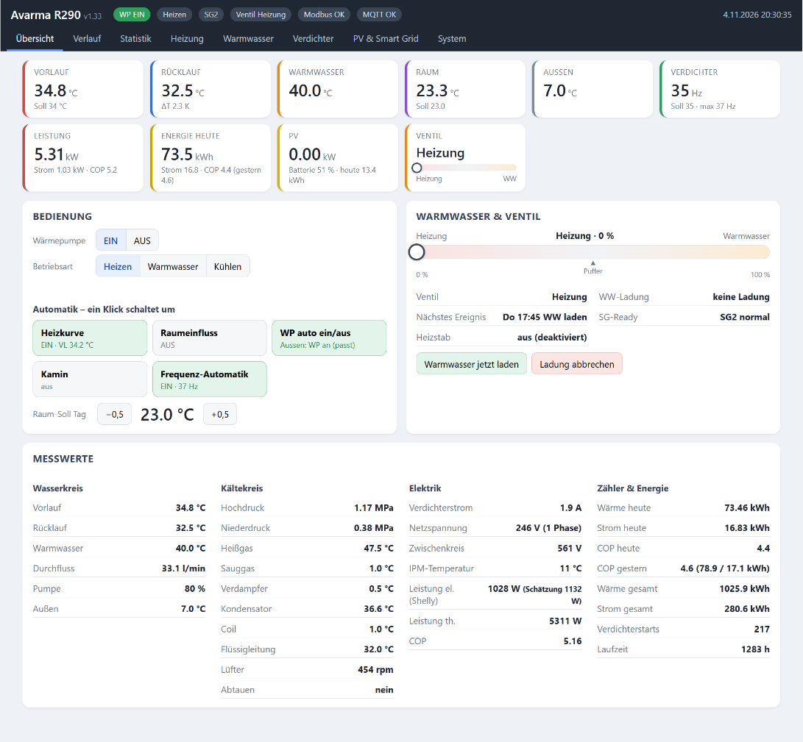

# Avarma R290 Steuerung (ESP32-S3 / Arduino GIGA)

Eigene Steuerung für die **Avarma R290 Monoblock-Wärmepumpe** über die **RS485/Modbus-Schnittstelle** der WP –
mit Web-Oberfläche (Browser und Handy), Touch-Display, Verlauf, Statistik, Heizkurve, Warmwasser-Steuerung,
Frequenz-Automatik und optionaler PV-Anbindung.

Es gibt zwei gleichwertige Fassungen mit derselben Versionsnummer:

| Ordner | Hardware |
|---|---|
| [`Avarma_R290_S3`](Avarma_R290_S3) | ESP32-S3 mit 2,8"-Touch-Display (Hosyond / LCDWIKI **ES3C28P**), Daten auf microSD |
| [`Avarma_R290_GIGA`](Avarma_R290_GIGA) | **Arduino GIGA R1 WiFi** mit **GIGA Display Shield** (800 × 480), Daten im internen Speicher |
| [`ESBE_Slave_R4`](ESBE_Slave_R4) | optional: Ventilmodul (Arduino UNO R4 Minima) für ein ESBE-Umschaltventil am RS485-Bus |
| [`nodered`](nodered) | optional: Node-RED-Flows für Victron (PV/Batterie → MQTT, SG-Ready) und Shelly |

Einstellungen lassen sich als Datei oder auf dem NAS sichern und zwischen ESP32 und GIGA austauschen.



> **Benutzung auf eigenes Risiko.** Die Steuerung schreibt Parameter in die WP (Vorlauf-Soll, max. Verdichterfrequenz,
> max. Lüfter, Betriebsart, Ein/Aus) – nur Werte, die man auch am Display der WP einstellen kann. Am Kältekreis wird nichts
> verändert. Wie sich das auf Garantie und Gewährleistung auswirkt, muss jeder selbst klären. 230-V-Arbeiten
> (Ventilmotor, Shelly) nur durch eine Elektrofachkraft.

---

## Funktionen

- **Übersicht** mit allen Werten der WP: Wasserkreis, Kältekreis (Hoch-/Niederdruck, Heißgas, Sauggas, Verdampfer, Coil …),
  Elektrik, Leistung, COP, Zähler
- **Verlauf** (14 Tage im 30-s-Raster, danach Stundenmittel) und **Statistik** (Tageswerte, Arbeitszahl, Kosten, Abtauungen, CSV)
- **Heizung:** eigene Heizkurve (7 Punkte), Raumeinfluss (P + I), Nachtabsenkung (fest oder als Kurve nach Außentemperatur,
  nachts WP ganz aus ab x °C), WP automatisch ein/aus mit Mindestlauf- und Pausenzeit, Kamin-Modus, Sperrzeiten
- **Warmwasser:** über ein vom ESP gesteuertes **Umschaltventil** *oder* über den **WW-Modus der WP** (siehe unten),
  Wochenplan, „Warmwasser jetzt“, Ladung vorziehen statt Verdichter-Stopp, Puffer-Automatik
- **Verdichter:** Frequenz-Automatik nach Außentemperatur (Heizen / WW getrennt, nachts leiser), sanft ausschalten,
  schneller abtauen, Frost-Bremse, Abtau-Auswertung
- **Strommessung** wahlweise geschätzt (Verdichterstrom × Spannung) oder **gemessen mit einem Shelly**
- **PV & Smart Grid (optional):** PV-Überschuss → Warmwasser, SG-Ready, Heizstab per Shelly, VL-Soll per MQTT
- **NAS-Archiv** per FTP (z. B. Synology), Einstellungen sichern/übertragen, Konsole, Firmware-Update per Browser (ESP)

Weitere Bilder: [docs/bilder](docs/bilder)

---

## Hardware und Verkabelung

Ausführlich mit Pin-Tabellen: **[docs/VERKABELUNG.md](docs/VERKABELUNG.md)**. Kurzfassung:

**Arduino GIGA R1 WiFi + GIGA Display Shield** – das Shield steckt hinten (J5/J6), alle Pins oben bleiben frei. 3,3-V-Logik!

| Funktion | GIGA-Pin |
|---|---|
| RS485 RO (Empfang) | D0 (RX, Serial1) |
| RS485 DI (Senden) | D1 (TX, Serial1) |
| RS485 DE + /RE (gebrückt) | D2 |
| RS485 VCC / GND | 3V3 / GND (3,3-V-Modul, z. B. MAX3485 / SP3485) |
| Raumfühler SHT4x (empfohlen) SDA / SCL | D20 / D21 |
| Raumfühler DHT22 Daten | D3 |
| Ventil-Relais Motorstrom / Richtung | D4 / D5 (nur ohne Ventilmodul) |
| Versorgung | USB-C 5 V (mind. 2 A) oder VIN 6–24 V |

**ESP32-S3 (ES3C28P)** – Erweiterungsstecker:

| Funktion | ESP-Pin |
|---|---|
| RS485 RO / DI / DE+RE | IO14 / IO21 / IO2 |
| Raumfühler DHT22 | IO3 |
| Ventil-Relais | frei wählbar im Web (IO43 / IO44), oder Ventilmodul am RS485-Bus |

**RS485 zur WP:** A an A, B an B (kommt keine Antwort: A und B tauschen), verdrilltes Paar, gemeinsame Masse.
WP = Modbus-ID 1, 9600 Baud (im Web änderbar).

---

## Strommessung mit Shelly (optional)

Ohne Shelly schätzt die Steuerung die Leistung aus Verdichterstrom und Spannung. Genauer (inkl. Pumpe, Lüfter, Elektronik) ist ein Shelly:

| WP-Anschluss | Shelly | Hinweis |
|---|---|---|
| Drehstrom (3 Phasen) | **Shelly Pro 3EM** (Stromzangen) | misst nur, nichts im Lastkreis |
| 1 Phase | **Shelly EM Gen3 / Pro EM** (Stromzange) | misst nur – empfohlen |
| 1 Phase, max. 16 A | **Shelly PM Mini Gen3** oder **Shelly 1PM (Plus / Gen3)** | liegt im Lastkreis: nur, wenn der maximale Strom der WP sicher unter 16 A liegt. Beim 1PM muss das Relais immer an bleiben (Einschaltzustand „an“, keine Abschalt-Automatik) |

Es gehen Shellys der Generation 2, 3 und 4 (Plus, Pro, Gen3 …), nicht die alten Gen1-Geräte.

**Einrichten**
1. Einen MQTT-Broker im Heimnetz (z. B. Mosquitto auf einem Raspberry Pi / Home Assistant, oder Venus OS).
2. In der Shelly-App bzw. Weboberfläche: *Einstellungen → MQTT* einschalten, Server `IP-des-Brokers:1883`,
   **MQTT-Präfix** z. B. `shelly-wp`, **„Generic status update over MQTT“** an.
3. In der Avarma-Oberfläche: *System → MQTT* den gleichen Broker eintragen,
   dann *System → Elektrische Leistung der WP*: Quelle **„Shelly per MQTT“**, Präfix `shelly-wp`.

Gelesen werden `status/em:0` + `emdata:0` (Pro 3EM), `status/em1:0` + `em1data:0` (EM), `status/switch:0` (1PM) bzw. `status/pm1:0` (PM Mini).
Sendet der Shelly 2 min nichts, nimmt die Steuerung automatisch wieder die Schätzung.

---

## Warmwasser – zwei Varianten

Einstellbar im Tab **Warmwasser → „Warmwasser über“**. Die nicht benötigten Teile werden in der Oberfläche ausgeblendet.

### A) WW-Modus der WP (Voreinstellung)
Für Anlagen, bei denen die **WP selbst** ihr 3-Wege-Ventil und den WW-Speicher steuert. Zur Ladung (Wochenplan,
„Warmwasser jetzt“, PV-Überschuss) stellt der ESP die WP auf **Betriebsart Warmwasser**; die WP schaltet ihr Ventil
und heizt bis zu **ihrem eigenen WW-Soll** (an der WP einstellen). Ist „Warmwasser laden bis“ erreicht oder schaltet die
WP im WW-Modus 3 min lang ab, stellt der ESP zurück auf Heizen. Der WW-Fühler der WP liefert die Speichertemperatur.

*Neu und noch wenig getestet – Rückmeldungen willkommen.*

### B) Umschaltventil, gesteuert vom ESP (so läuft es bei mir)
Die WP bleibt immer im **Heizbetrieb**. Ein **ESBE-3-Wege-Ventil mit 3-Punkt-Stellmotor** sitzt im Vorlauf und verteilt
das Heizwasser zwischen Heizkreis und der Wendel im WW-Speicher. Der Stellmotor hängt an zwei Relais
(Motorstrom + Richtung) – direkt am ESP/GIGA oder am **Ventilmodul** [`ESBE_Slave_R4`](ESBE_Slave_R4) am RS485-Bus.

| Stellung | Wirkung |
|---|---|
| 0 % **Heizung** | nur Heizkreis |
| 100 % **WW** | Heizwasser durch die Speicherwendel – Speicher wird geladen |
| 50 % **Puffer** | ein Teil fließt durch den Speicher: er wirkt als zusätzlicher Puffer für die Heizung, die WP taktet weniger |

So nutze ich meinen Speicher (Beispielwerte):
- **WW-Ladung** täglich nach Wochenplan (17:45): Ventil auf WW, VL-Soll = WW-Soll (47 °C) + 4 K. Erreicht der VL den Soll,
  bevor das Wasser warm ist, wird der VL-Soll bis max. 60 °C mitgezogen, damit der Verdichter nicht abschaltet.
- Danach **direkt weiterheizen**: Ventil sofort auf Heizung, der Verdichter läuft durch; der Heiz-VL-Soll wird erst gesetzt,
  wenn das kalte Heizungswasser angekommen ist.
- **WW-Ladung vorziehen:** Würde der Verdichter beim Heizen kurz vor der geplanten Ladung abschalten, wird die Ladung
  (bis zu 45 min) vorgezogen – ein Verdichterstart weniger.
- **Puffer-Automatik:** Nach der Ladung bleibt das Ventil auf Heizung, bis der Speicher abgekühlt ist (fest z. B. auf 35 °C
  oder auf wenige K über dem Heiz-VL-Soll) – dann **Puffer bis zur nächsten Ladung**. Ist die WP aus, steht das Ventil
  immer auf Heizung, damit nichts durch den Speicher zirkuliert.

---

## PV / Victron (optional)

Bei mir liefert eine **Victron-Anlage (Cerbo / Venus OS)** über **Node-RED** PV-Leistung, Batterie-SoC, Netzbezug und
Hausverbrauch per MQTT, und Node-RED schickt bei Überschuss SG-Ready 3/4 → Warmwasser wird höher geladen.

**Das braucht man nicht:** Heizung, Warmwasser, Frequenz-Automatik, Verlauf, Statistik und NAS laufen ohne PV.
Der ganze PV-Teil ist ab Werk **ausgeblendet** und lässt sich unter **System → Funktionen** einschalten.
Er erwartet nur ein paar MQTT-Werte und kann deshalb auch aus Home Assistant, ioBroker oder einem anderen Node-RED kommen:

| Topic | Inhalt |
|---|---|
| `avarma/pv/power` | PV-Leistung W |
| `avarma/pv/soc` | Batterie % |
| `avarma/pv/bat` | Batterie W (+ = laden) |
| `avarma/pv/grid` | Netz W (+ = Bezug) |
| `avarma/pv/house` | Hausverbrauch W |
| `avarma/pv/today`, `yesterday` | PV-Ertrag kWh (optional) |
| `avarma/cmd/sg` | SG-Ready 1–4 (regelmäßig wiederholen) |

Weitere Befehle: `avarma/cmd/vl`, `wwload`, `power`, `mode`, `valve`, `heater`, `console`; Status unter `avarma/state` (JSON).
Flows für Victron und Shelly: [`nodered`](nodered).

---

## Installation

### WLAN-Zugangsdaten eintragen
Im Sketch oben (ESP: `Avarma_R290_S3.ino`, GIGA: `Avarma_R290_GIGA.ino`) nach **`HIER DEINE WLAN-ZUGANGSDATEN EINTRAGEN`** suchen:

```cpp
static const char* WIFI_SSID = "DEIN_WLAN_NAME";
static const char* WIFI_PASS = "DEIN_WLAN_PASSWORT";
...
static const char* OTA_PASSWORD = "bitte-aendern";   // ESP: Passwort für den Upload per Netzwerk
```

Alles andere (MQTT, NAS, Shelly, Heizkurve …) wird später in der Web-Oberfläche eingestellt und im Gerät gespeichert.

### ESP32-S3 (ES3C28P)
- Arduino-IDE 2.x, Boardpaket **„esp32“ von Espressif (3.x)**
- Werkzeuge: Board „ESP32S3 Dev Module“, USB CDC On Boot „Enabled“, Flash Size „16MB“, PSRAM „OPI PSRAM“,
  Partition Scheme „16M Flash (3MB APP/9.9MB FATFS)“
- Bibliotheken: **LovyanGFX** (lovyan03), **ModbusMaster** (Doc Walker)
- microSD-Karte (FAT32) einlegen

### Arduino GIGA R1 WiFi
- Boardpaket **„Arduino Mbed OS GIGA Boards“**, Board „Arduino GIGA R1 WiFi“, Target core „Main Core“
- Bibliotheken: **Arduino_GigaDisplay_GFX**, **Arduino_GigaDisplayTouch**, **Arduino_USBHostMbed5**, **PubSubClient**, **ModbusMaster**
- Einmalig: Beispiele → STM32H747_System → **QSPIFormat**, danach **WiFiFirmwareUpdater** – Details in
  [`Avarma_R290_GIGA/LIESMICH_GIGA.txt`](Avarma_R290_GIGA/LIESMICH_GIGA.txt)

### Erster Start
1. Hochladen, die IP-Adresse steht auf dem Display (ESP auch `http://avarma.local`). Im Router am besten eine feste IP vergeben.
2. Im Browser öffnen. Oben muss **„Modbus OK“** stehen – sonst A/B tauschen bzw. Pins/Baudrate unter System → Modbus prüfen.
3. Schritt für Schritt einschalten: Heizkurve, Warmwasser (Variante wählen), Frequenz-Automatik … Ab Werk ist alles aus,
   was in die WP schreibt.
4. Optional: MQTT, Shelly, NAS-Ablage, PV-Teil (System → Funktionen).

Die Weboberfläche ist für das **Heimnetz** gedacht (kein Login). Nicht ins Internet freigeben – für den Zugriff von unterwegs VPN nutzen.

---

## Lizenz

MIT – siehe [LICENSE](LICENSE). Schrift „Inter“ (GIGA-Display): SIL Open Font License.
